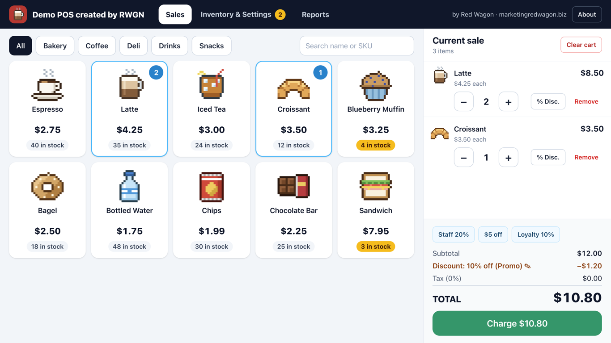
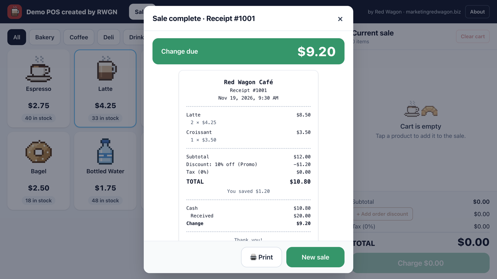

# Demo POS created by RWGN

**by Red Wagon · [marketingredwagon.biz](https://marketingredwagon.biz)**

An **offline desktop Point-of-Sale** for a small café or convenience store, built with Electron, React and TypeScript.
It runs entirely on one computer. It needs no internet connection, has no accounts and no cloud, and makes no network requests.
All data is stored locally in a single JSON file.



<!-- Screenshot placeholder: replace docs/screenshot-*.png with your own captures if you change the UI. -->

| Sale complete, with change and receipt |
| --- |
|  |

## Features

- **Sales**: product grid with pixel-art images, category tabs, search, and stock badges (amber when low, red when out).
  Cart with +/− and remove. Cart quantity can never exceed stock.
- **Discounts**: whole-order or per-line, as a percentage or a fixed $ amount, with an optional note (e.g. "Staff").
  One-tap presets. A discount can never make a total negative.
- **Payments** (manual entry, because there is no internet):
  - **Cash**: amount received, quick buttons (exact / $20 / $50 / $100), automatic change.
  - **Card**: record only. The card is run on a separate standalone terminal. Stores card type, optional last 4 digits and
    optional approval number. It **never** asks for a full card number, expiry date or CVV.
  - **Split**: part cash, part card. The two must add up to the total.
- **Receipts**: printable at receipt width (80 mm), with a "New sale" button.
- **Inventory**: edit products, receive stock, adjust stock (damaged / count correction / other), add and archive products,
  full stock-movement history, low-stock alert.
- **Settings**: store name (shown on receipts), tax rate, discount presets.
- **Data tools**: export a backup, import a backup, reset the demo data.
- **Reports**: sales list for any date range, receipt view, void a sale (returns its items to stock), daily summary
  (gross, discounts, tax, net, transactions, cash vs card, top products), and CSV export.

## Requirements

- **Node.js 20.19+** (Node 22 LTS recommended): <https://nodejs.org>
- Windows 10/11 or macOS 12+
- No compilers or build tools needed: the app uses no native modules.

## Install and run

The commands are the same on **Windows** (PowerShell or Command Prompt) and **macOS** (Terminal):

```bash
git clone https://github.com/ArtyKourakin/demo-pos.git
cd demo-pos
npm install
npm run dev        # starts the app with hot reload
```

On the first run, Electron downloads its runtime (about 100 MB, one time only). After that, the app never needs the internet.

### Other scripts

| Command | What it does |
| --- | --- |
| `npm run dev` | Run the app in development mode |
| `npm test` | Run the unit tests (Vitest) |
| `npm run build` | Type-check and build the production bundle into `out/` |
| `npm run preview` | Run the production build without packaging |
| `npm run dist` | Build an app for **the current OS** into `dist/` |
| `npm run dist:win` | Windows portable `.exe` (`dist/DemoPOS-<version>-portable.exe`). Also works from macOS. |
| `npm run dist:mac` | macOS `.dmg`, universal for Intel and Apple Silicon (`dist/DemoPOS-<version>.dmg`). macOS only. |
| `npm run dist:all` | Both of the above (run it on macOS) |

**Windows**: the portable `.exe` needs no installation. Double-click it. It isn't code-signed, so SmartScreen may warn you.
Click **More info → Run anyway**.

**macOS**: open the `.dmg` and drag *Demo POS* to Applications. The build is ad-hoc signed, not notarized, so the first time,
right-click the app → **Open** → **Open**. (Or run `xattr -cr "/Applications/Demo POS.app"`.)

## Where the data is stored

Everything lives in one file, `pos-data.json`:

| OS | Location |
| --- | --- |
| Windows | `%APPDATA%\Demo POS\pos-data.json` (e.g. `C:\Users\<you>\AppData\Roaming\Demo POS\pos-data.json`) |
| macOS | `~/Library/Application Support/Demo POS/pos-data.json` |
| Linux | `~/.config/Demo POS/pos-data.json` |

You can also find it in the app under **Inventory & Settings → Settings & data → Show in folder**. The About dialog shows the path too.

- **Atomic writes**: every save writes a temporary file, flushes it to disk, then renames it over the real file.
  A crash or power cut can't leave a half-written file.
- If the file is ever unreadable, it's moved aside (`pos-data.unreadable-<date>.json`) instead of being deleted, and
  fresh demo data is created.
- Only the Electron main process reads or writes the file. The UI talks to it through a small, typed IPC API.

## Demo script (about 3 minutes)

1. **Prove it's offline.** Turn off Wi-Fi (and unplug Ethernet). Open the app. Everything below works without a connection.
2. **Make a sale with a discount and cash.**
   - On **Sales**, tap **Latte** twice and **Croissant** once. The subtotal is $12.00.
   - Tap **+ Add order discount** → **Percent** → `10`, tap the **Promo** note → **Apply discount**.
     The cart shows −$1.20 and a total of **$10.80**.
   - Tap **Charge $10.80** → **Cash** → **$20** → **Complete sale**.
   - The receipt shows **Change due $9.20**. Optionally click **Print**, then **New sale**.
3. **Inventory went down.** Open **Inventory & Settings**: Latte is down from 35 to **33** and Croissant from 12 to **11**.
   **Stock history** shows the "Sale · Receipt #1001" entries.
4. **Card payment (manual record).** Back on **Sales**, tap **Chips** → **Charge** → **Card** → **Visa**, last 4 `4242`,
   approval `083412` → **Complete sale**. Point out that the app never asks for the full card number, expiry or CVV.
5. **Receive stock for a low item.** In **Inventory & Settings**, the banner says *"2 items running low"*.
   Tap **Blueberry Muffin: 4 left** (or **+ Receive** on its row) → `12` → note "Morning delivery" → **Receive +12**.
   The muffin goes to 16 and drops off the low-stock list (now "1 item running low": the Sandwich).
6. **Reports.** Open **Reports** (defaults to **Today**). Show gross sales, discounts, net revenue, the transaction count,
   and **Cash $10.80 vs Card $1.99**. Click a sale to see its receipt. Optionally **Void sale** to show the items going
   back into stock. **Export CSV** saves the report locally.
7. **Show the local data.** **Inventory & Settings → Settings & data**: point at the file path and click **Show in folder**,
   then **Export backup** to save a copy of the JSON file anywhere you like.

To run the demo again from a clean slate, use **Settings & data → Reset demo data**. This restores the 10 seed products
and clears all sales.

## Project structure

```
src/
  shared/            Pure, framework-free logic shared by main + renderer (unit-tested)
    types.ts           Data model
    money.ts           Integer-cents math, parsing, formatting
    pos.ts             Cart totals, discounts, payments, complete sale, void, stock ops
    reports.ts         Date-range filtering, summaries, CSV export
    seed.ts            10 demo products
    icons.ts           Original 16×16 pixel-art icons (rendered as crisp SVG)
    validate.ts        Data-file / backup validation
    ipc.ts             Typed IPC contract
  main/
    index.ts           Window, offline lockdown, menu, IPC handlers
    store.ts           JSON file persistence with atomic writes
  preload/index.ts   contextBridge → window.pos (contextIsolation on, nodeIntegration off, sandbox on)
  renderer/          React + Tailwind UI
tests/               Vitest unit tests
scripts/             generate-icon.mjs (app icon from the pixel art)
```

### Design notes

- **Money is integer cents everywhere.** Percentages are integer basis points (10% = 1000), and rounding is half-up in
  integer math, so there are no floating-point surprises.
- **Totals**: line price × qty − line discount = line net. Σ line nets = subtotal. Subtotal − order discount = taxable.
  Taxable + tax = total. Every discount is capped at the amount it applies to.
- **Completing a sale is one atomic step.** The main process runs a single pure function. It saves the sale, decrements
  stock and logs a movement per item, and returns the new state, which is persisted in one file replace.
  The same goes for voids, stock receipts and adjustments.
- **Offline by construction**:
  - A strict Content-Security-Policy (`connect-src 'none'`, `default-src 'self'`).
  - The main process cancels every non-`file:` request.
  - Popups and navigation are blocked, the spellchecker (which downloads dictionaries) is off, and only system fonts are used.
  - The single external link, marketingredwagon.biz, is opened by the main process in your default browser via
    `shell.openExternal`. The URL is hard-coded there.

## Troubleshooting

- **`npm install` warns about install scripts.** That's harmless. Electron downloads its runtime the first time it starts.
- **The app starts as plain Node / "Cannot read properties of undefined (reading 'isPackaged')".** Your shell has
  `ELECTRON_RUN_AS_NODE=1` set (some editor-integrated terminals set it). Run from a normal terminal, or clear the variable
  first: `unset ELECTRON_RUN_AS_NODE` (macOS), or `Remove-Item Env:ELECTRON_RUN_AS_NODE` (PowerShell).

## License

[MIT](LICENSE) © 2026 Red Wagon
